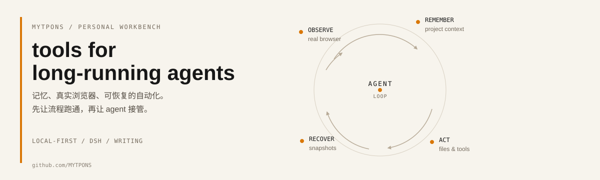

# MYTPONS

独立开发者。喜欢把反复出现的问题做成工具，再让 agent 接管它们。

## 现在

我在做一套让 agent 能持续工作的底层能力：

- **记住上下文**：让下一次会话知道上次为什么做、做到哪、什么还没做。
- **进入真实浏览器**：不是截图 API，而是能点击、输入、切换标签的浏览器会话。
- **在动手前留下退路**：不可重建的文件有快照，覆盖和删除有保留期。
- **把过程写下来**：长篇小说、产品方向和逆向研究，都应该留下可检查的轨迹。

## 最近公开

- [dsh-project-memory](https://github.com/MYTPONS/dsh-project-memory) — 记录、日志、文档、功能清单，以及主存档和恢复。
- [dsh-browser-cdp](https://github.com/MYTPONS/dsh-browser-cdp) — 给 agent 一套 `browser_*` 工具，默认持久 Firefox，也可切到 Chromium/CDP。
- [dsh-backup](https://github.com/MYTPONS/dsh-backup) — 一个自动清理保留期的文件快照仓库。

## 也会写点别的

- [draftvein](https://github.com/MYTPONS/draftvein) — 逐章推进的长篇小说写作工作台。
- [blackbox-web-reverse](https://github.com/MYTPONS/blackbox-web-reverse) — 面向授权目标的黑盒 Web 逆向工作流。
- [idea-collider](https://github.com/MYTPONS/idea-collider) — 把两个领域的硬约束碰在一起，找可开工的方向。

## 偏好

- 本地优先，能自己掌握的数据不要默认上云。
- 工具要能恢复，失败要能解释。
- 先跑通最小闭环，再谈抽象和漂亮。
- 人可以审查 agent，而不是把决定权全部交出去。

## 工具

`JavaScript` · `TypeScript` · `Python` · `Go` · `Kotlin/Android` · `Node.js` · `Linux` · `Cordis/DSH`

## 找到我

- [公开仓库](https://github.com/MYTPONS?tab=repositories)
- [最近更新](https://github.com/MYTPONS?tab=repositories&sort=updated)
- 有问题就开 issue，或者直接看对应仓库的 README。

> 这里只放公开作品。私密工作、凭据、本地 profile 和项目记忆不公开。
