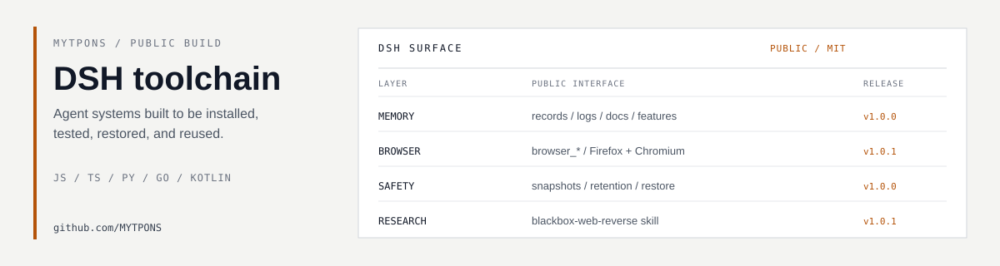

# MYTPONS

`DSH tooling` · `agent systems` · `local-first automation`

我把 DeepSeek Harness（DSH）当作一个可扩展的运行时，而不是一次性聊天窗口。当前主线是把备份、项目记忆、浏览器控制和逆向研究工作流做成**可安装、可恢复、可验证**的工具。

## DSH toolchain

| Layer | Repository | Public surface | Release | CI |
|---|---|---|---|---|
| Memory | [dsh-project-memory](https://github.com/MYTPONS/dsh-project-memory) | `project_*` tools: records, logs, docs, feature checklist, bounded search, archive/restore | [v1.0.0](https://github.com/MYTPONS/dsh-project-memory/releases/tag/v1.0.0) |  |
| Browser | [dsh-browser-cdp](https://github.com/MYTPONS/dsh-browser-cdp) | `browser_*` tools over persistent Firefox or Chromium/CDP sessions | [v1.0.1](https://github.com/MYTPONS/dsh-browser-cdp/releases/tag/v1.0.1) |  |
| Safety | [dsh-backup](https://github.com/MYTPONS/dsh-backup) | One self-pruning snapshot store for files outside version control | [v1.0.0](https://github.com/MYTPONS/dsh-backup/releases/tag/v1.0.0) |  |

这些仓库都是 DSH bundle，不是通用 SaaS 或空壳 demo。安装路径、工具边界、测试和 Release 都写在各自 README 里。

## Selected work

| Project | Type | What it does |
|---|---|---|
| [draftvein](https://github.com/MYTPONS/draftvein) | TypeScript · writing | 逐章推进的 AI 长篇小说写作工作台，含伏笔台账、质量审稿与作家助手草稿递交 |
| [blackbox-web-reverse](https://github.com/MYTPONS/blackbox-web-reverse) | Agent skill · research | 面向授权目标的黑盒 Web 逆向工作流：前端、接口契约、数据模型与证据包 |
| [idea-collider](https://github.com/MYTPONS/idea-collider) | Python · product research | 把两个领域的硬约束求交集，用证据过滤生成可开工的产品方向 |
| [nodegrid](https://github.com/MYTPONS/nodegrid) | Python · distributed systems | 服务器控制免公网节点的分布式任务框架，带风险分级抽查与完整性探针 |
| [AppDian](https://github.com/MYTPONS/AppDian) | Android · data tools | 用 JSON 规则聚合应用列表、详情与下载地址的应用软件库 |

## Working rules

1. **Ship the interface, not just the demo.** 能安装、能升级、能恢复，再谈“完成”。
2. **Evidence over vibes.** 文档、测试、CI、Release 和可复现命令优先于口头结论。
3. **Local-first by default.** 记忆、快照和浏览器 profile 不默认上云；敏感数据不进入公开仓库。
4. **Separate the layers.** DSH 工具、Agent skill、业务应用各自有边界，不把所有能力塞进一个巨型插件。

## Stack

`JavaScript` · `TypeScript` · `Python` · `Go` · `Kotlin/Android` · `Node.js` · `Linux` · `Cordis/DSH`

## Find the work

- [All public repositories](https://github.com/MYTPONS?tab=repositories)
- [Recently updated repositories](https://github.com/MYTPONS?tab=repositories&sort=updated)
- [Open an issue](https://github.com/MYTPONS/dsh-project-memory/issues) for project-memory questions, or use the relevant repository's issue tracker.

> Public profile only. Private work, credentials, local profiles, and project memory are not published here.
